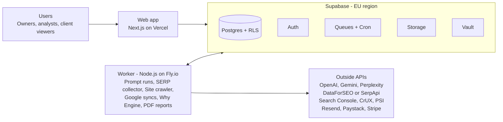

# Rootspun by XP — Project Specification

Nov 2, 2026 · @JB

## Overview

**Rootspun by XP** is a white-label SaaS platform that SEO agencies rent to measure each client's visibility in Google's organic results and in AI answers (AI Overviews, AI Mode, ChatGPT, Gemini, Perplexity, later Claude and Copilot), explain why it moved, and turn that into fixes grounded in Google's own documentation. It is built on Supabase (Postgres, Auth, Storage, Queues, Cron) by a team of six developers.

**One-month target: 50% of the project, measured in estimated developer-days.** The full scope is about 200 developer-days across five phases. Phases 0, 1 and 2 total about 100 developer-days and finish at the end of week 4, giving agencies a working tracker, a technical lab and the first version of the Why Engine. Phases 3 and 4 follow in weeks 5–8.

At the end of month 1, a pilot agency can sign up, add a client, track 300 prompts across Google and three AI engines, see a Unified Visibility Score with competitor share of voice, read the likely cause of each loss, and send a branded PDF report.

Story IDs use the format **RS-PNN** (P = phase, NN = number). Estimates are in developer-days and include tests and code review.

## Team and timeline

Six developers working in one-week sprints, each owning a lane so work runs in parallel. Owners named in the story tables below use these codes.

| Code | Role | Owns |
| --- | --- | --- |
| D1 | Tech lead / backend | Architecture, schema, RLS, code review, Why Engine |
| D2 | Backend / data | Scoring, metrics, Search Console and analytics sync |
| D3 | Integrations | SERP API, LLM APIs, extraction, usage metering |
| D4 | Crawler / technical SEO | Crawler, Core Web Vitals, robots and log analysis |
| D5 | Frontend lead | App shell, dashboards, design system |
| D6 | Frontend / reports | Onboarding flows, reports, white-label, client portal |

| Phase | Weeks | Dev-days | Share of project | Milestone |
| --- | --- | --- | --- | --- |
| 0 · Foundation | 1 | 18 | 9% | Repo, database, auth and worker running |
| 1 · MVP tracker | 1–3 | 46 | 23% | Pilot agency tracks clients and sends a report |
| 2 · Tech Lab + Why Engine v1 | 3–4 | 36 | 18% | **50% complete** — causes shown for each loss |
| 3 · Fix Studio + white-label | 5–6 | 48 | 24% | Agencies resell under their own brand |
| 4 · Proof Loop + scale | 7–8 | 49 | 25% | Billing, API, measured lift, launch |
| **Total** | **8** | **197** | **100%** |  |

Capacity check: six developers × 20 working days = 120 dev-days in month 1. Phases 0–2 need 100, leaving about 20 for meetings, bugs and pilot feedback. There is little slack, so scope is cut before dates slip (see Risks).

## Functional requirements

The system must do the following. "Must" items are in the month-1 scope; "Should" items land in weeks 5–8.

| ID | Requirement | Priority | Phase |
| --- | --- | --- | --- |
| FR-01 | Agencies sign up, invite team members and assign roles: owner, admin, analyst, client viewer | Must | 0 |
| FR-02 | Every record is isolated per agency; no agency can read another's data | Must | 0 |
| FR-03 | Agencies add clients, each with domains, brand names, competitors, country and language | Must | 1 |
| FR-04 | Agencies build prompt sets per client: import CSV, type manually, or generate from seed keywords; tag by topic and intent | Must | 1 |
| FR-05 | Track each prompt in Google organic results, AI Overviews and AI Mode (position, cited URL) | Must | 1 |
| FR-06 | Sample answers from ChatGPT, Gemini and Perplexity, three runs per prompt per engine, on a schedule | Must | 1 |
| FR-07 | Extract brand mentions, cited URLs and sentiment from every answer | Must | 1 |
| FR-08 | Calculate the Unified Visibility Score (0–100) and competitor share of voice per client, engine, topic and day | Must | 1 |
| FR-09 | Connect Google Search Console by OAuth (read-only) and sync performance data daily | Must | 1 |
| FR-10 | Produce a branded PDF report per client per period | Must | 1 |
| FR-11 | Meter usage (prompt runs, crawled pages) per agency and stop runs at the plan limit | Must | 1 |
| FR-12 | Crawl a client site: status codes, canonicals, robots.txt, meta robots, `nosnippet`, rendered vs raw HTML | Must | 2 |
| FR-13 | Pull Core Web Vitals field data (LCP, INP, CLS) per page template from CrUX and PageSpeed Insights | Must | 2 |
| FR-14 | Check whether Googlebot and AI crawlers can reach the site (robots.txt, CDN, uploaded server logs) | Must | 2 |
| FR-15 | Store Google's rules as a library and flag when Search Central documentation changes | Must | 2 |
| FR-16 | For every lost ranking or citation, show the most likely cause with its evidence and the Google rule behind it | Must | 2 |
| FR-17 | Email alerts when a client's score drops past a threshold | Must | 2 |
| FR-18 | Map each money query to the sub-questions AI engines search for, and show coverage gaps | Should | 3 |
| FR-19 | Check entity facts (name, address, founders, products) are consistent across the web | Should | 3 |
| FR-20 | Turn each cause into a fix ticket or a content brief with sources; export to Jira, Asana or Slack | Should | 3 |
| FR-21 | Block any output that breaks Google spam policies (scaled content, doorway pages, site reputation abuse) | Should | 3 |
| FR-22 | Full white-label: agency logo, colours, custom domain and email sender; client portal logins | Should | 3 |
| FR-23 | Record when a fix ships and measure before/after lift in score, clicks and citations | Should | 4 |
| FR-24 | Rank future fixes using anonymised lift data from all agencies | Should | 4 |
| FR-25 | Add Claude and Microsoft Copilot as tracked engines | Should | 4 |
| FR-26 | Public REST API with per-agency keys | Should | 4 |
| FR-27 | Subscription billing with plan limits and usage top-ups (Paystack for South Africa, Stripe elsewhere) | Should | 4 |
| FR-28 | Free single-domain AI visibility audit page for lead generation | Should | 4 |

## Non-functional requirements

| ID | Area | Requirement |
| --- | --- | --- |
| NFR-01 | Security | Row Level Security on every table, keyed on `agency_id`; service-role key used only in workers, never in the browser |
| NFR-02 | Security | OAuth tokens and API keys encrypted at rest (Supabase Vault); Google scopes read-only |
| NFR-03 | Privacy | Compliant with POPIA and GDPR: data export and deletion per client within 30 days; DPA available to agencies |
| NFR-04 | Performance | Dashboard pages load in under 2 s at p75; API reads under 300 ms at p95 |
| NFR-05 | Scale | Month-1 target: 20 agencies, 200 clients, 60,000 prompt runs per day; design to grow 10× without a rewrite |
| NFR-06 | Reliability | 99.5% monthly uptime for the app; every worker job retried 3 times with backoff and sent to a dead-letter queue after |
| NFR-07 | Accuracy | Each AI prompt run 3 times per engine; results shown as a share with a confidence note, never a single yes/no |
| NFR-08 | Data freshness | Priority prompts refreshed daily, others weekly; Search Console synced daily |
| NFR-09 | Cost | LLM and SERP cost per prompt run logged; alert when an agency's cost passes 70% of its plan revenue |
| NFR-10 | Compliance | Data comes from official APIs and licensed SERP providers only; no scraping of Google or chat apps |
| NFR-11 | Observability | Structured logs, error tracking and a job dashboard (queue depth, failures, cost per day) |
| NFR-12 | Quality | 70% unit test coverage on scoring and Why Engine; end-to-end tests on sign-up, tracking and reports; CI blocks merges on failure |
| NFR-13 | Accessibility | WCAG 2.2 AA for the agency app and client portal |
| NFR-14 | Usability | A new agency adds its first client and sees first results in under 15 minutes |
| NFR-15 | Maintainability | TypeScript strict mode, one monorepo, typed database (generated Supabase types), migrations in version control |
| NFR-16 | Backups | Daily database backups with point-in-time recovery; restore tested once a month |

## Architecture

The web app only reads and writes through Supabase with the user's own session, so RLS protects every query. All slow or costly work runs in the worker, which pulls jobs from Supabase Queues, calls the outside APIs, and writes results back.



pg\_cron puts scheduled jobs (daily prompt runs, syncs, Docs Watcher) on the queue; the web app adds on-demand jobs such as "run now" or "build report".

## Tech stack and installation

One TypeScript monorepo, with Supabase doing the heavy lifting so the team doesn't run its own database, auth, queue or scheduler.

| Layer | Choice | Why |
| --- | --- | --- |
| Database | Supabase Postgres | Relational data, RLS for multi-tenancy, SQL for scoring |
| Auth | Supabase Auth | Email, Google sign-in, team invites, JWT claims for `agency_id` and role |
| Queue and scheduling | Supabase Queues (pgmq) + pg\_cron | Prompt runs and crawls as jobs; no separate Redis |
| File storage | Supabase Storage | PDF reports, uploaded log files, agency logos |
| Secrets | Supabase Vault | Encrypted OAuth tokens and API keys |
| Web app | Next.js (App Router) + Tailwind CSS + shadcn/ui | Dashboards, onboarding, client portal |
| Charts | Recharts | Score trends, share of voice |
| Workers | Node.js service on Fly.io or Railway | Long jobs: prompt runs, crawling, syncs |
| Crawler | Crawlee + Playwright | Raw and rendered HTML, respects robots.txt |
| SERP data | DataForSEO or SerpApi (licensed) | Organic results plus AI Overview and AI Mode blocks |
| AI engines | OpenAI, Google Gemini, Perplexity APIs; Anthropic added in phase 4 | Answer sampling |
| Google data | Search Console API, CrUX API, PageSpeed Insights API | Performance and Core Web Vitals |
| Email | Resend | Alerts, invites, reports |
| PDF | @react-pdf/renderer | Branded reports |
| Billing | Paystack (ZA) + Stripe (rest of world) | Phase 4 |
| Monitoring | Sentry + PostHog | Errors, product analytics |
| Testing | Vitest + Playwright Test | Unit and end-to-end |
| Hosting | Vercel (web), Fly.io or Railway (workers) | Simple deploys from GitHub |

**Every developer installs:** Node.js LTS, pnpm, Docker Desktop (for local Supabase), Supabase CLI, Git, and VS Code or Cursor.

**Accounts to create (D1, day 1):** GitHub organisation, Supabase (two projects: staging and production, EU region), Vercel, Fly.io or Railway, OpenAI, Google Cloud (Gemini API, Search Console API, CrUX API, PSI API, OAuth client), Perplexity API, DataForSEO or SerpApi, Resend, Sentry, PostHog.

```bash
# Create the monorepo
pnpm dlx create-turbo@latest rootspun
cd rootspun

# Web app
pnpm --filter web add @supabase/supabase-js @supabase/ssr zod recharts @react-pdf/renderer resend posthog-js @sentry/nextjs
pnpm dlx shadcn@latest init

# Worker
pnpm --filter worker add @supabase/supabase-js openai @google/genai crawlee playwright googleapis zod pino @sentry/node
pnpm --filter worker exec playwright install chromium

# Shared tooling
pnpm add -Dw typescript vitest @playwright/test eslint prettier

# Local Supabase
supabase init
supabase start
supabase gen types typescript --local > packages/db/src/types.ts
```

Perplexity's API is OpenAI-compatible, so the `openai` package serves it with a different base URL.

## File structure

A Turborepo monorepo: two apps (web and worker), shared packages, and Supabase migrations in one place.

```text
rootspun/
├── apps/
│   ├── web/                        # Next.js agency app + client portal
│   │   ├── app/
│   │   │   ├── (auth)/             # sign-in, sign-up, invite accept
│   │   │   ├── (app)/
│   │   │   │   ├── dashboard/      # agency overview
│   │   │   │   ├── clients/[id]/
│   │   │   │   │   ├── visibility/ # UVS, engines, share of voice
│   │   │   │   │   ├── prompts/    # prompt sets
│   │   │   │   │   ├── technical/  # crawl, CWV, crawler access
│   │   │   │   │   ├── causes/     # Why Engine results
│   │   │   │   │   ├── fixes/      # Fix Studio (phase 3)
│   │   │   │   │   └── reports/
│   │   │   │   └── settings/       # team, branding, billing, integrations
│   │   │   ├── portal/             # client-facing white-label views
│   │   │   └── api/                # route handlers, OAuth callbacks, public API
│   │   ├── components/
│   │   ├── lib/                    # supabase clients, auth helpers
│   │   └── e2e/                    # Playwright tests
│   └── worker/                     # Node.js job runner
│       ├── src/
│       │   ├── queue/              # pgmq consumer, retries, dead-letter
│       │   ├── jobs/
│       │   │   ├── serp-run.ts     # Google organic, AI Overviews, AI Mode
│       │   │   ├── llm-run.ts      # ChatGPT, Gemini, Perplexity sampling
│       │   │   ├── extract.ts      # mentions, citations, sentiment
│       │   │   ├── score.ts        # UVS and share of voice
│       │   │   ├── gsc-sync.ts
│       │   │   ├── crawl.ts
│       │   │   ├── cwv-sync.ts
│       │   │   ├── crawler-access.ts
│       │   │   ├── docs-watch.ts   # Search Central change detection
│       │   │   ├── why-engine.ts
│       │   │   └── report-pdf.ts
│       │   ├── providers/          # one adapter per outside API
│       │   └── index.ts
│       └── test/
├── packages/
│   ├── db/                         # generated types, typed queries
│   ├── core/                       # scoring formulas, Why Engine rules (pure functions)
│   ├── rules/                      # Google rules library (JSON + loaders)
│   ├── ui/                         # shared shadcn components, charts
│   └── config/                     # eslint, tsconfig, tailwind presets
├── supabase/
│   ├── migrations/                 # SQL migrations, RLS policies
│   ├── functions/                  # edge functions (webhooks)
│   ├── seed.sql                    # demo agency, engines, rules
│   └── config.toml
├── docs/                           # this spec, ADRs, runbooks
├── .github/workflows/              # CI: lint, typecheck, test, migrate
├── turbo.json
├── pnpm-workspace.yaml
└── .env.example
```

## Database schema

Every tenant table carries `agency_id`, and one RLS policy pattern guards them all: a user sees a row only if they are a member of that agency. Large time-series tables are partitioned by month.

| Table | Key columns | Phase |
| --- | --- | --- |
| `agencies` | id, name, plan, branding (jsonb), custom\_domain | 0 |
| `memberships` | agency\_id, user\_id, role (owner, admin, analyst, client\_viewer), client\_id (for viewers) | 0 |
| `clients` | id, agency\_id, name, country, language | 1 |
| `domains` | id, client\_id, host, is\_primary | 1 |
| `competitors` | id, client\_id, name, host | 1 |
| `brand_terms` | id, client\_id, term, type (brand, product, person) | 1 |
| `prompts` | id, client\_id, text, topic, intent, priority, search\_volume | 1 |
| `engines` | id, code (google\_organic, ai\_overview, ai\_mode, chatgpt, gemini, perplexity, claude, copilot) | 1 |
| `runs` | id, prompt\_id, engine\_id, run\_at, sample\_no, raw\_ref (storage path), cost\_usd | 1 |
| `mentions` | id, run\_id, entity (client or competitor), position, sentiment | 1 |
| `citations` | id, run\_id, url, host, is\_client, rank | 1 |
| `scores_daily` | client\_id, engine\_id, topic, date, uvs, share\_of\_voice | 1 |
| `integrations` | id, agency\_id, client\_id, provider (gsc, ga4), vault\_secret\_id, status | 1 |
| `gsc_daily` | client\_id, date, query, page, clicks, impressions, position | 1 |
| `usage_events` | agency\_id, kind (prompt\_run, page\_crawl), qty, cost\_usd, at | 1 |
| `reports` | id, client\_id, period, storage\_path, created\_by | 1 |
| `crawls` / `pages` | crawl\_id, url, status, canonical, robots, nosnippet, rendered\_diff, template | 2 |
| `cwv_metrics` | client\_id, template, lcp\_ms, inp\_ms, cls, source (crux, psi), date | 2 |
| `crawler_access` | client\_id, bot (googlebot, gptbot, …), allowed, blocked\_by (robots, cdn), checked\_at | 2 |
| `google_rules` | id, title, url, summary, checksum, last\_changed\_at | 2 |
| `causes` | id, client\_id, prompt\_id, engine\_id, type, evidence (jsonb), rule\_id, confidence, status | 2 |
| `alerts` | id, client\_id, kind, threshold, last\_fired\_at | 2 |
| `fixes` | id, cause\_id, kind (dev, content, pr), brief (jsonb), external\_ref, shipped\_at | 3 |
| `fix_outcomes` | fix\_id, metric, before, after, window\_days | 4 |
| `api_keys` | id, agency\_id, hash, scopes, last\_used\_at | 4 |
| `subscriptions` | agency\_id, provider, plan, status, period\_end | 4 |

```sql
-- RLS pattern used on every tenant table
create policy "members read own agency" on clients
  for select using (
    agency_id in (select agency_id from memberships where user_id = auth.uid())
  );
```

## Phase 0 — Foundation (week 1, 18 dev-days)

Goal: by Friday of week 1, every developer can run the whole stack locally, deploy to staging, and sign in.

| ID | User story | Acceptance criteria | Owner | Days | Week |
| --- | --- | --- | --- | --- | --- |
| RS-001 | As a developer, I want a monorepo with CI so that everyone ships the same way | Turborepo with web, worker and packages; GitHub Actions run lint, typecheck and tests on every PR; staging deploys on merge to main | D1 | 3 | 1 |
| RS-002 | As a developer, I want the base schema and RLS so that tenant data is safe from day one | Migrations for agencies, memberships, clients; RLS on every table; a test proves agency A cannot read agency B | D1, D2 | 4 | 1 |
| RS-003 | As an agency owner, I want to sign up and invite my team so that we can work together | Email and Google sign-in; invite by email; roles owner, admin, analyst, client viewer enforced in UI and database | D6 | 3 | 1 |
| RS-004 | As a user, I want a clean app shell so that the product feels consistent | Navigation, agency switcher, client switcher, light and dark themes, empty states; shadcn/ui components in `packages/ui` | D5 | 4 | 1 |
| RS-005 | As a developer, I want a worker that pulls jobs from Supabase Queues so that long tasks run reliably | pgmq queues created; worker consumes, retries 3× with backoff, sends failures to dead-letter; pg\_cron enqueues a test job hourly; logs reach Sentry | D3, D4 | 4 | 1 |

## Phase 1 — MVP tracker (weeks 1–3, 46 dev-days)

Goal: a pilot agency tracks its clients across Google and three AI engines and sends a branded report. Stories start in week 1 once RS-002 and RS-005 are merged.

| ID | User story | Acceptance criteria | Owner | Days | Week |
| --- | --- | --- | --- | --- | --- |
| RS-101 | As an analyst, I want to add a client with domains, brand terms and competitors so that tracking knows who to look for | Form with validation; up to 10 competitors; duplicate domains rejected; client appears in switcher | D6 | 3 | 1–2 |
| RS-102 | As an analyst, I want to build a prompt set so that we track the questions buyers actually ask | CSV import (text, topic, intent); manual add; "suggest prompts" from 5 seed keywords via LLM; tag and filter; 300 prompts per client in MVP | D5, D3 | 4 | 2 |
| RS-103 | As an analyst, I want each prompt tracked in Google organic, AI Overviews and AI Mode so that I see classic and AI search together | SERP provider adapter; stores rank, AI block presence, cited URLs; daily for priority prompts, weekly for others; cost logged per call | D3 | 6 | 2 |
| RS-104 | As an analyst, I want answers sampled from ChatGPT, Gemini and Perplexity so that I see how AI assistants describe the brand | One adapter per engine; 3 runs per prompt per engine; raw answer saved to Storage; rate limits and retries handled | D3, D4 | 6 | 2 |
| RS-105 | As an analyst, I want mentions, citations and sentiment extracted so that answers become data | Brand and competitor mentions with position; cited URLs normalised to host; sentiment positive, neutral or negative; spot-check of 100 answers ≥ 90% correct | D2 | 5 | 2–3 |
| RS-106 | As an agency owner, I want one Unified Visibility Score and share of voice so that clients get a number they understand | Score 0–100 weighted by search volume; per engine, topic and day; formula documented in `packages/core` with unit tests | D2 | 4 | 3 |
| RS-107 | As an analyst, I want to connect Search Console so that real clicks sit next to visibility | Google OAuth with read-only scope; token stored in Vault; daily sync of 16 months on first connect, then daily | D2 | 4 | 2 |
| RS-108 | As an analyst, I want a client visibility dashboard so that I can see what changed at a glance | Score trend, score by engine, competitor share of voice, top gained and lost prompts, filter by topic and date; loads under 2 s | D5 | 6 | 2–3 |
| RS-109 | As an agency owner, I want a branded PDF report so that I can send results to clients | Agency logo and colours; score, trends, wins and losses, next steps; generated in under 60 s; stored and emailed | D6 | 4 | 3 |
| RS-110 | As the platform owner, I want usage metered per agency so that costs never exceed plan revenue | Every run writes a usage event with cost; runs pause at plan limit with a banner; admin view of cost per agency per day | D1 | 4 | 3 |

## Phase 2 — Tech Lab and Why Engine v1 (weeks 3–4, 36 dev-days)

Goal: every lost ranking or AI citation shows a likely cause with evidence and the Google rule behind it. **End of week 4 = 50% of the project.**

| ID | User story | Acceptance criteria | Owner | Days | Week |
| --- | --- | --- | --- | --- | --- |
| RS-201 | As an analyst, I want the client site crawled so that technical blockers are found | Crawlee + Playwright; up to 5,000 pages per client in MVP; records status, canonical, robots.txt, meta robots, `nosnippet`, raw vs rendered text difference; pages grouped by template | D4 | 7 | 3–4 |
| RS-202 | As an analyst, I want Core Web Vitals per template so that I fix the slowest page types first | CrUX API for origin and URL field data; PSI for templates without field data; LCP, INP, CLS against Google's good thresholds (2.5 s, 200 ms, 0.1) | D2 | 4 | 3 |
| RS-203 | As an analyst, I want to know if Googlebot and AI crawlers can reach the site so that nothing is blocked by mistake | robots.txt parsed per bot (Googlebot, Google-Extended, GPTBot, PerplexityBot and others); live fetch test for CDN blocks; upload of server log file shows bot hits per day | D4 | 5 | 4 |
| RS-204 | As the platform owner, I want Google's rules stored and watched so that advice stays current | `google_rules` seeded from Search Central pages (AI features, Search Essentials, spam policies, helpful content, Core Web Vitals); daily checksum job flags changes for review | D1 | 4 | 3 |
| RS-205 | As an analyst, I want the likely cause of each loss so that I know what to fix | Rules engine in `packages/core` covering: not indexed, snippet blocked, robots or CDN block, slow template, competitor cited instead, no page answers the prompt; each cause has evidence, confidence and a linked Google rule; unit tests per rule | D1, D2 | 8 | 4 |
| RS-206 | As an analyst, I want a causes view so that I can triage quickly | List sorted by impact (search volume × lost visibility); filter by type, engine, topic; detail panel with evidence and "why Google cares" link; mark as accepted or dismissed | D5 | 5 | 4 |
| RS-207 | As an agency owner, I want an email when a client's score drops so that we react before the client notices | Threshold per client (default −5 points week on week); email via Resend with top 3 causes; no more than one alert per client per day | D6 | 3 | 4 |

## Phase 3 — Fix Studio and white-label (weeks 5–6, 48 dev-days)

Goal: causes turn into work an agency can ship, under the agency's own brand.

| ID | User story | Acceptance criteria | Owner | Days | Week |
| --- | --- | --- | --- | --- | --- |
| RS-301 | As an analyst, I want each money query expanded into its sub-questions so that I see what AI engines search for | LLM generates 8–15 sub-questions per prompt; each mapped to the best client page or marked as a gap; coverage % per topic | D3 | 8 | 5 |
| RS-302 | As an analyst, I want brand facts checked across the web so that AI engines describe the client correctly | Agency enters canonical facts; tool compares them with AI answers and top cited pages; mismatches listed with source URL | D2 | 6 | 5–6 |
| RS-303 | As an analyst, I want a fix ticket for each accepted cause so that developers know exactly what to do | Ticket with title, steps, affected URLs, Google rule link and expected impact; status open, in progress, shipped | D1 | 6 | 5 |
| RS-304 | As a content lead, I want a content brief for each coverage gap so that writers create pages AI engines cite | Brief lists the questions to answer, entities, sources to cite, competitor pages cited today, and suggested structured data; editable before export | D3, D5 | 6 | 6 |
| RS-305 | As the platform owner, I want a spam guardrail so that Rootspun never recommends what Google penalises | Blocks briefs that create near-duplicate pages at scale, city doorway pages, or third-party content on a host domain; each block cites the spam policy; tests cover each pattern | D1 | 5 | 6 |
| RS-306 | As an analyst, I want to export fixes to Jira, Asana or Slack so that they land in the team's workflow | OAuth connect per agency; export one or many tickets; link back to Rootspun; status sync from Jira | D4 | 5 | 6 |
| RS-307 | As an agency owner, I want full white-label so that clients only see my brand | Logo, colours, favicon; custom domain with automatic SSL; emails sent from the agency's domain; no Rootspun mentions in portal or reports | D6 | 8 | 5–6 |
| RS-308 | As a client, I want my own login so that I can see progress any time | Client viewer role sees only their client: score, trends, shipped fixes and reports; cannot see prompts' costs or other clients | D5 | 4 | 6 |

## Phase 4 — Proof Loop and scale (weeks 7–8, 49 dev-days)

Goal: prove which fixes work, charge for the product, and open it to more agencies.

| ID | User story | Acceptance criteria | Owner | Days | Week |
| --- | --- | --- | --- | --- | --- |
| RS-401 | As an agency owner, I want before/after results for each shipped fix so that I can prove our work moved the numbers | When a fix is marked shipped, baseline is frozen; after 14 and 28 days, change in score, citations and Search Console clicks is shown with a control group of untouched prompts | D2 | 7 | 7 |
| RS-402 | As an analyst, I want fixes ranked by proven lift so that we do the highest-value work first | Anonymised lift stored per fix type across agencies (opt-in); fix list sorted by expected lift; no agency or client data exposed | D1, D2 | 8 | 7–8 |
| RS-403 | As an analyst, I want Claude and Copilot tracked too so that coverage matches where buyers ask | Anthropic adapter; Copilot via licensed provider or API where available; same extraction and scoring | D3 | 5 | 7 |
| RS-404 | As a developer at an agency, I want a REST API so that I can pull data into our own tools | API keys per agency with scopes; endpoints for clients, scores, causes, fixes; rate limited; OpenAPI docs | D3 | 6 | 8 |
| RS-405 | As the platform owner, I want subscription billing so that agencies pay automatically | Paystack for South Africa, Stripe elsewhere; Starter, Growth, Scale plans; usage top-ups; failed payment pauses runs after 7 days | D6 | 6 | 7–8 |
| RS-406 | As a prospect, I want a free AI visibility audit so that I see the value before I buy | Public page; enter domain and 3 competitors; 20 prompts across 3 engines; emailed result with sign-up link; abuse limits per IP | D5 | 5 | 8 |
| RS-407 | As the platform owner, I want the system load-tested and security-reviewed so that launch is safe | Load test at 10× month-1 volume; RLS penetration tests; dependency scan; POPIA/GDPR data export and deletion working | D4 | 8 | 8 |
| RS-408 | As a new agency, I want guided onboarding so that I see first results in 15 minutes | Checklist: add client, import prompts, connect Search Console, run first check; in-app tips; help docs | D5, D6 | 4 | 8 |

## Definition of done and risks

A story is done only when all of these are true:

- [ ] Acceptance criteria met and shown in a demo
- [ ] Code reviewed and merged; CI green (lint, typecheck, tests)
- [ ] New tables have migrations and RLS policies with a cross-tenant test
- [ ] Deployed to staging and checked by a second developer
- [ ] Costs of any new outside API call are logged in `usage_events`
- [ ] Short note added to `docs/` for anything another developer must know

| Risk | Impact on the 1-month target | Mitigation |
| --- | --- | --- |
| Little slack: 100 of 120 dev-days planned | Any blocker pushes Phase 2 past week 4 | Cut order if late: RS-207 alerts, then RS-203 log upload, then RS-206 filters; never cut RLS or tests |
| SERP provider lacks reliable AI Mode data | RS-103 incomplete | Trial DataForSEO and SerpApi in week 1; build the adapter so providers can be swapped |
| API answers differ from the consumer chat apps | Agencies question accuracy | Label as API sample; 3 runs per engine; show share, not yes/no |
| LLM and SERP costs higher than planned | Margins | RS-110 metering and limits from week 3; weekly refresh for low-priority prompts |
| Why Engine causes are wrong | Loss of trust | Pilot SEO lead reviews 100 causes in week 4; rules ship with confidence levels |
| Google OAuth app verification takes weeks | Search Console sync delayed for external users | Apply in week 1; use test users for pilot agencies meanwhile |
| Data residency for South African clients | POPIA questions from agencies | Host in Supabase EU region with a signed DPA; document cross-border transfer basis |
